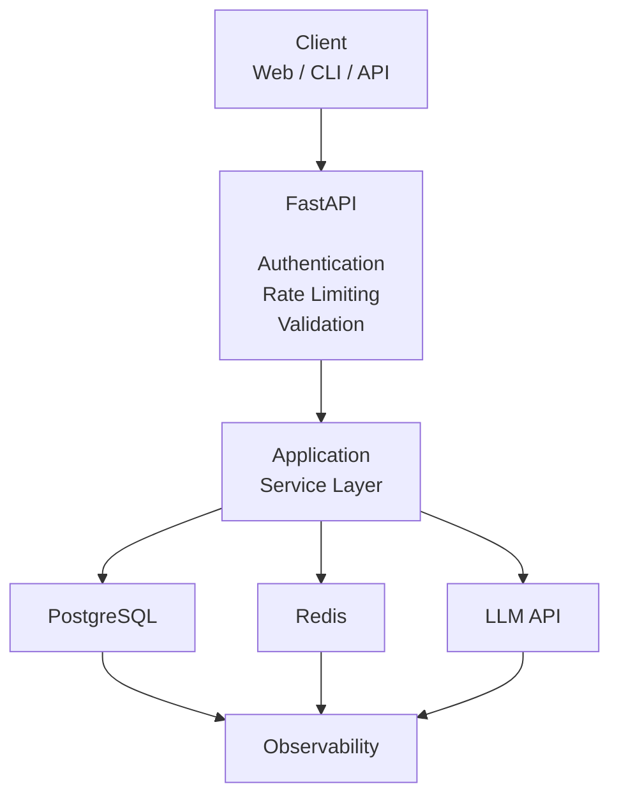

## Hojat's roadmap for becoming an AI Engineer

Hojat is interested to become an AI engineer by doing real-world projects. 
This repo is a roadmap and also a container for te projects he is going to do in this regard. 

## Phase 1 - AI research assistant

My goal for this project is to create an API which takes users' questions and produces AI-generated answers.

**`Main philosophy`: Don't add a technology just because you can; add it only if it solves a problem.**

The general stuff that I intend to cover:

<ol>
<li>Building AI APIs with FastAPI</li>
<li>Async Python</li>
<li>LLM API integration</li>
<li>Structured outputs</li>
<li>Streaming responses</li>
<li>PostgreSQL</li>
<li>Redis caching</li>
<li>Authentication</li>
<li>Error handling and retries</li>
<li>Logging and observability</li>
<li>Testing</li>
<li>Docker</li>
<li>CI/CD basics</li>
<li>Performance measurement</li>

**And in the next iteration of the project I wanna go for these:**
<li>conversations</li>
<li>streaming</li>
<li>response caching</li>
<li>structured outputs</li>
<li>API keys</li>
<li>tracing</li>
<li>more metrics</li>
<li>more testing</li>
</ol>

The architecture I have in mind for this project is something like this :



User will send a request like this :

```json
{
  "question": "Explain to me about Iran's history during Ashkanian dynasty."
}
```

And my system's response will be something like this :

```json
{
  "answer": "...",
  "metadata": {
    "model": "...",
    "latency_ms": 1234,
    "input_tokens": 500,
    "output_tokens": 300
  }
}
```

**I care about separation of concern, which in this context means, te HTTP route should not know about which LLM is used for creating the response. **